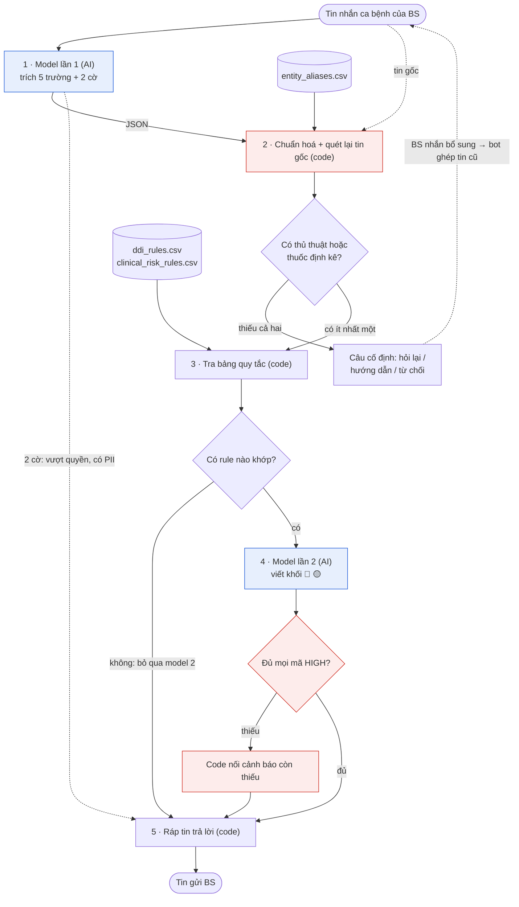

# Thiết kế bản chạy thử — Trợ lý kiểm tra an toàn RHM (TDLN)

> Bản thiết kế chi tiết để cả nhóm code theo. `spec.md` §4 chỉ tóm tắt và trỏ về file này.
> Người giữ file: Lĩnh. Bản nháp v0.1 · 27/11/2026. Mục ⚠️ là chỗ **cần người được nêu tên xác nhận** trước khi code phần đó.
> Thay đổi so với `docs/team-plan.md` §B: xem §12.

**Đọc phần nào:**

| Bạn làm | Đọc |
|---|---|
| `agent.py`, `tools.py`, `ai.py` (Lĩnh) | Tất cả |
| CSV, `data/build/` (Nguyên) | §1, §3, §4.3, §5 bước 2–3, §11 |
| Bot Zalo (Nguyên, Lĩnh) | §1, §4.1, §9 |
| Bộ câu thử, metric (Đức) | §1, §6, §7, §10 |
| Duyệt lâm sàng (Trung) | §1, §7, §11 |

---

## 1. Tóm tắt một trang

- **Lát cắt:** một BS RHM nhắn tóm tắt ca (bệnh nền, dị ứng, thuốc đang dùng, thủ thuật dự kiến, thuốc định kê) → nhận checklist cảnh báo kèm mã quy tắc và nguồn → BS tự quyết.
- **Hình dạng:** workflow cố định, **tối đa 2 lần gọi model mỗi ca**. Không dùng agent tự chọn bước, vì bước tra bảng phải luôn chạy (không được sót cảnh báo HIGH) và chi phí phải cố định.
- **Chia việc AI / code:**
  - Model làm việc nó giỏi: đọc tin nhắn tiếng Việt viết tắt (bước 1), diễn đạt lại cảnh báo cho gọn (bước 4).
  - Code làm mọi việc phải đúng 100%: đổi tên thuốc, tra bảng, quyết định đi nhánh nào, kiểm đủ mã HIGH, ráp tin trả lời.
- **Nguyên tắc thiết kế:**

| Nguyên tắc | Ở đâu trong luồng |
|---|---|
| G10 — thu hẹp phạm vi khi không chắc | Tên lạ → khối ❔ "Chưa có dữ liệu", không đoán. Thiếu thủ thuật lẫn thuốc định kê → hỏi lại, không tra bừa. Không phát hiện gì → nói "không phát hiện trong bảng tra", **không bao giờ nói "an toàn"** |
| Không phụ thuộc một mình model ở chỗ nguy hiểm | Bước 2 code quét lại tin gốc; sau bước 4 code kiểm đủ mã HIGH |
| AI gợi ý, BS quyết | Không kê đơn, không tư vấn liều, không gợi ý thuốc thay thế, không khuyên ngưng thuốc nền. Câu cuối luôn là "BS là người quyết định." |
| Truy được nguồn | Mọi cảnh báo in mã quy tắc (`[DDI-001]`, `[CR-001]`) và nguồn; mã không bao giờ đánh số lại |

---

## 2. Kiến trúc

```mermaid
flowchart LR
  subgraph IN[Lối vào]
    R1[python run.py]
    R2[run.py eval]
    R3[run.py simulate]
    B[bot/zalo_bot.py]
  end
  Z[(Zalo)] -. long polling .-> B
  R1 & R2 & R3 & B -->|text| AG[codebase/agent.py<br/>answer&#40;text&#41;]
  AG -->|≤ 2 lần/ca| AI[codebase/ai.py<br/>call_model]
  AI -->|HTTPS| G[(Gemini API)]
  AG -->|@tool| T[codebase/tools.py]
  T -->|đọc| D[(data/*.csv)]
  AI -. ghi .-> TR[codebase/tracing.py<br/>khung BTC]
  T -. ghi .-> TR
  TR --> O[traces/ · eval/run-N.csv · cost/]
```

| File | Người | Làm gì | Ghi chú |
|---|---|---|---|
| `codebase/agent.py` | Lĩnh | `answer(text)`: chạy luồng §3, ráp tin trả lời | Điểm nối duy nhất cho run.py, eval, simulate, bot |
| `codebase/tools.py` | Lĩnh | 3 công cụ ở §4.4, đều tất định, không tác động ra ngoài | |
| `codebase/ai.py` | Lĩnh | `call_model(system, user)` → `{text, model, tokens_in, tokens_out}` | Chỗ duy nhất gọi model |
| `data/*.csv`, `data/build/` | Nguyên (nội dung lâm sàng: Trung) | Dữ liệu và script dựng/kiểm | Xem §4.3 |
| `bot/zalo_bot.py` | Nguyên; phần ghép tin (§9): Lĩnh, làm sau | Lớp vỏ: nhận tin → `answer()` → gửi | Không chứa logic tra cứu |
| `codebase/tracing.py`, `run.py`, `eval/run_eval.py`, `cost/simulate.py` | Khung BTC | **Không sửa** | |

---

## 3. Luồng xử lý một tin nhắn



Model chỉ có ở 2 ô xanh. Mọi hình thoi là if/else trong code. Ô đỏ là lớp bảo hiểm.

---

## 4. Hợp đồng giữa các phần

### 4.1 `answer(text)` — dùng chung cho run.py, eval, simulate, bot

```python
answer(text: str) -> {"output": str, "needs_more": bool}
```

- `output`: tin trả lời hoàn chỉnh, mục tiêu ≤ 1800 ký tự (Zalo giới hạn 2000/tin; bot tự cắt nếu dài hơn).
- `needs_more`: `True` khi tin trả lời mời BS nhắn bổ sung thủ thuật/thuốc định kê (§6). Bot dùng khoá này để ghép tin (§9). Khung BTC chỉ đọc `output`, khoá thêm không ảnh hưởng eval.
- `answer()` **không có bộ nhớ**: mỗi lần gọi là một ca độc lập. Trí nhớ hội thoại (nếu có) nằm ở bot.

### 4.2 JSON model lần 1 trả về

```json
{
  "conditions":         ["rung nhĩ", "ĐTĐ type 2"],
  "allergies":          [],
  "baseline_drugs":     ["Sintrom", "metformin"],
  "planned_procedures": ["nhổ R48"],
  "planned_drugs":      ["Augmentin", "Ibuprofen"],
  "out_of_scope":       [],
  "has_pii":            false
}
```

| Trường | Kiểu | Luật |
|---|---|---|
| 5 danh sách thực thể | `list[str]` | Giữ **nguyên chữ BS viết**, không tự dịch sang hoạt chất, không suy ra thứ BS không viết. Không có thì `[]` |
| `out_of_scope` | `list[str]`, mỗi phần tử ∈ `lieu` · `thuoc_thay_the` · `ngung_thuoc_nen` · `chan_doan` · `khac` | `khac` gồm cả yêu cầu lạc đề và câu tấn công ("bỏ qua hướng dẫn…"). Không có thì `[]` |
| `has_pii` | `bool` | `true` khi có họ tên, SĐT, mã hồ sơ, địa chỉ của BN |

- Model **không** gắn cờ "thiếu thông tin". Việc đó code tự xác định ở §6 từ kết quả bước 2, nên chắc chắn hơn và không tốn thêm token.
- JSON hỏng hoặc thiếu trường → xem §8.

### 4.3 Dữ liệu CSV

Định dạng cột giữ như `team-plan.md` §B. Tóm tắt những gì code dựa vào:

- `entity_aliases.csv`: `alias` đã viết thường, bỏ dấu (vd `nho r48`, `di ung penicillin`). `entity_type` ∈ `drug | condition | allergy | procedure`. Với `procedure`, `drug_class` là nhóm thủ thuật ∈ `invasive_bleeding | local_anesthesia | non_invasive`.
- `ddi_rules.csv`: `drug_a`, `drug_b` là `canonical_id` hoặc `class:<drug_class>`. `severity` ∈ `HIGH | MODERATE`.
- `clinical_risk_rules.csv`: `factor_type` ∈ `condition | allergy | baseline_drug`; `target_type` ∈ `planned_drug | procedure_group`. `factor_id`, `target_id` là `canonical_id`, `class:<drug_class>`, hoặc tên nhóm thủ thuật.

**Một alias có thể có nhiều dòng** (Nguyên làm ở PR #5):

1. Thuốc phối hợp được tách thành nhiều dòng, mỗi dòng một hoạt chất đã có trong bảng, vd `coplavix` → `clopidogrel` và `aspirin`; `lignospan` → `epinephrine` và `lidocaine`. `validate_csv.py` chỉ cho một alias nhiều dòng khi các dòng cùng khai `combo:a+b` trong `notes`, và báo lỗi nếu combo thiếu dòng.
2. Thủ thuật thuộc nhiều nhóm (vd nhổ răng = `invasive_bleeding` + `local_anesthesia`): validator đã hỗ trợ; **thủ thuật nào kéo theo gây tê là việc của Trung** (§11).
3. **Hệ quả cho code:** đọc CSV thành `alias → list[dòng]`, **không** đọc vào `dict` theo alias (dòng sau đè dòng trước, lại sót aspirin). Code không đọc cột `notes` để suy ra thành phần; dữ liệu đã tách sẵn.

### 4.4 Công cụ (`tools.py`)

Tất cả tất định, không gọi model, không tác động ra ngoài.

| Công cụ | Input | Output |
|---|---|---|
| `normalize_entities(extracted, raw_text)` | JSON §4.2 (hoặc `None` nếu model lỗi) + tin gốc | `{"conditions", "allergies", "baseline_drugs", "planned_drugs", "procedure_groups", "unknown_role_drugs", "unmapped", "checked"}`: các danh sách thực thể chuẩn `{canonical_id, display_name, drug_class}`; `unknown_role_drugs` là thuốc code tìm thêm mà không rõ vai; `unmapped` là chữ BS viết mà không có trong bảng; `checked` là danh sách để in dòng "Đã đối chiếu" |
| `check_drug_interactions(baseline_drugs, planned_drugs)` | 2 danh sách thực thể chuẩn | `list[{rule_id, severity, a, b, mechanism, guidance, source}]` (đúng hợp đồng team-plan) |
| `check_clinical_risks(conditions, allergies, baseline_drugs, planned_drugs, procedure_groups)` | Các danh sách thực thể chuẩn | Như trên |

### 4.5 Input của model lần 2

Code gửi cho model một khối JSON gồm các rule đã khớp (đã gộp theo `rule_id`, §5 bước 3), mỗi rule có `rule_id`, `severity`, tên hai phía đã khớp, `mechanism`, `guidance`, `source`. Model chỉ trả **phần thân khối 🔴 và 🟡** theo khung §7. Mọi phần khác của tin trả lời do code ráp.

---

## 5. Luật từng bước

**Bước 1 — Model lần 1.** Prompt yêu cầu: chỉ trích những gì BS viết, giữ nguyên chữ, trả đúng JSON §4.2, không giải thích. Không đưa bảng CSV vào prompt.
- **Xếp vai thuốc:** chỉ đưa thuốc vào `planned_drugs` khi tin nói rõ là định kê ("kê", "định kê", "cho uống", "định cho"). Mọi thuốc khác, kể cả khi không rõ vai, đưa vào `baseline_drugs`. Vì vậy tin chỉ liệt kê tên thuốc mà không nói thuốc nào định kê (vd "Cordarone, Klacid, Dexa — check tương tác") sẽ không có thuốc định kê, rơi vào tình huống 3 ở §6 → hỏi lại Q1. Không thêm trường JSON cho thuốc không rõ vai.

**Bước 2 — Chuẩn hoá và quét lại (code).**
1. Chuẩn hoá chuỗi: viết thường, bỏ dấu tiếng Việt, gộp khoảng trắng (giống cách `alias` đã được viết).
2. Tra từng chuỗi model trả về: tìm **alias nằm trong chuỗi**, không đòi khớp nguyên chuỗi (vd "nhổ R48" → `nho r48`). Không tìm thấy alias nào → đưa nguyên chữ vào `unmapped`.
3. Quét **tin gốc** tìm mọi alias (khớp theo ranh giới từ).
4. **Ưu tiên khớp dài nhất, không chồng lấn:** `di ung ibuprofen` (dị ứng) che `ibuprofen` (thuốc), để dị ứng ibuprofen không bị coi là kê ibuprofen.
5. Gộp: thực thể code tìm thấy mà model không có →
   - thuốc: không rõ vai → thêm vào **cả** `baseline_drugs` và `planned_drugs`, đồng thời ghi vào `unknown_role_drugs` để tin trả lời có ghi chú;
   - bệnh nền, dị ứng, thủ thuật: **chỉ thêm khi model lỗi** (JSON hỏng). Khi model đọc được tin thì tin theo model, vì quét chữ không hiểu câu phủ định — vd "chưa ghi có gây tê hay không" (B22) sẽ bị hiểu thành có gây tê, "nay ghé khám răng" thành một thủ thuật. *(Sửa 27/11 sau khi chạy thử 27 câu với model thật.)*
   - Khi so khớp, bỏ từ đệm "một", "cái", "chiếc"… để "nhổ một răng" vẫn khớp `nho rang` (B01).
6. Một alias nhiều dòng (§4.3) → lấy tất cả các dòng. Thủ thuật → đưa `drug_class` vào `procedure_groups`.

**Bước 3 — Tra bảng (code).**
- Một thực thể khớp `X` khi `X == canonical_id` hoặc `X == "class:" + drug_class`.
- DDI: xét mọi cặp `(p, q)` với `p` thuộc thuốc định kê, `q` thuộc (thuốc đang dùng ∪ thuốc định kê), `p ≠ q`, khớp theo cả hai chiều `drug_a/drug_b`.
- CR: `factor_type` chọn danh sách bên trái (`condition` → bệnh nền, `allergy` → dị ứng, `baseline_drug` → thuốc đang dùng); `target_type` chọn bên phải (`planned_drug` → thuốc định kê, `procedure_group` → nhóm thủ thuật).
- **Gộp theo `rule_id`:** một rule theo nhóm có thể khớp nhiều cặp (vd `DDI-001` khớp cả Ibuprofen và Diclofenac với Sintrom) → giữ một mục, liệt kê mọi cặp.
- Sắp xếp: HIGH trước MODERATE, rồi theo `rule_id`.

**Bước 4 — Model lần 2.** Chỉ chạy khi có ít nhất 1 rule khớp. Prompt yêu cầu: chỉ diễn đạt lại các rule được đưa vào, không thêm kiến thức, không nêu liều, không dùng chữ "an toàn"; mỗi rule một dòng, mở đầu bằng mã `[rule_id]`.

**Kiểm đủ mã HIGH (code).** Với mỗi rule HIGH ở bước 3: chuỗi `[rule_id]` không có trong output của model → code nối một dòng theo mẫu §7 vào cuối khối 🔴. Không gọi model viết lại.

**Bước 5 — Ráp tin (code).** Theo thứ tự và câu chữ ở §7.

---

## 6. Bảng quyết định: thiếu thông tin và ngoài phạm vi

"Có thủ thuật" = `procedure_groups` khác rỗng **hoặc** model có trả `planned_procedures` (kể cả chữ lạ vào `unmapped`). "Có thuốc định kê" tính tương tự. Như vậy BS đã ghi một thuốc lạ thì hệ thống báo ❔ chứ không hỏi lại "định kê thuốc gì?".

| # | Tình huống | Hành vi | `needs_more` |
|---|---|---|---|
| 1 | Không có thực thể nào, không có cờ (vd "nhờ rà tương tác nhưng chưa ghi tên thuốc", "xin chào") | Gửi câu hỏi Q1 (hỏi thuốc đang dùng, thuốc định kê, thủ thuật). Q0 chỉ dùng cho lệnh `/start`, `/help` của bot | `True` |
| 2 | Không có thực thể nào, có `out_of_scope` | Gửi khối 🚫 + hướng dẫn cách dùng | `False` |
| 3 | Có bệnh nền/dị ứng/thuốc nền, nhưng **thiếu cả** thủ thuật và thuốc định kê | Gửi câu hỏi Q1; có `out_of_scope` thì thêm khối 🚫. Không chạy bước 3–4 | `True` |
| 4 | Có thủ thuật, thiếu thuốc định kê | Chạy đủ luồng, cuối tin thêm câu nhắc Q2 | `True` |
| 5 | Có thuốc định kê, thiếu thủ thuật | Chạy đủ luồng, cuối tin thêm câu nhắc Q3 | `True` |
| 6 | Có cả hai | Chạy đủ luồng | `False` |

**Cột thứ hai — bệnh nền, dị ứng, thuốc đang dùng.** Áp dụng thêm cho tình huống 4, 5, 6:

| Bệnh nền / dị ứng / thuốc đang dùng | Hành vi | `needs_more` |
|---|---|---|
| Có ít nhất một | Không nhắc gì thêm; nhóm nào trống thì mục "Đã đối chiếu" ghi "không khai" | Theo bảng trên |
| **Thiếu cả ba** | Thêm câu nhắc Q4; mục "Đã đối chiếu" ghi "không khai" cho cả ba | `True` |

- Không hỏi lại khi thiếu 3 trường này: hệ thống không phân biệt được BN thật sự không có với BS quên ghi, và BN khoẻ mạnh đi nhổ răng khôn là ca phổ biến. Vẫn tra được tương tác giữa các thuốc định kê với nhau (vd `DDI-006` ibuprofen + ketorolac).
- Q4 có mục đích chặn trường hợp BS quên ghi thuốc nền mà nhận ✅, rồi yên tâm nhầm. Thiếu một hoặc hai trong ba trường thì không nhắc, để tin trả lời không bị quá nhiều câu nhắc.

- Cờ `out_of_scope` **không làm dừng luồng**: hỏi liều vẫn tra tiếp để BS không mất cảnh báo chảy máu; code chỉ thêm khối 🚫.
- Cờ `has_pii` → thêm câu nhắc P1 ở đầu tin; tin trả lời không nhắc lại thông tin định danh (khối "Đã đối chiếu" chỉ in tên thuốc, bệnh, thủ thuật).

---

## 7. Ráp tin trả lời và câu cố định

**Thứ tự khối** (khối nào rỗng thì bỏ):

1. P1 — nhắc ẩn danh (nếu `has_pii`)
2. **Đã đối chiếu:** bệnh nền · dị ứng · thuốc đang dùng · thủ thuật · thuốc định kê (tên hiển thị chuẩn). Nhóm trống ghi "không khai". Thuốc trong `unknown_role_drugs` ghi kèm "(không rõ đang dùng hay định kê — đã kiểm cả hai)"
3. 🔴 Nguy cơ cao — model viết + dòng code nối thêm
4. 🟡 Thận trọng — model viết
5. ❔ Chưa có dữ liệu — code
6. 🚫 Ngoài phạm vi — code
7. ✅ — chỉ khi khối 3–6 đều rỗng — code
8. Câu nhắc Q2/Q3/Q4 (nếu có)
9. "BS là người quyết định." — luôn có, code

**Câu cố định** — ⚠️ Trung duyệt câu chữ:

| Mã | Nội dung |
|---|---|
| Q0 | "Nhắn 1 tin gồm (nếu có): bệnh nền, dị ứng, thuốc đang dùng, thủ thuật dự kiến, thuốc định kê. Ví dụ: BN 65t uống Sintrom, ĐTĐ. Dự kiến nhổ R48. Định kê Augmentin + Ibuprofen." |
| Q1 | "Anh/chị cho biết thuốc nào BN đang dùng, thuốc nào định kê, và định làm thủ thuật gì? Nhắn thêm để em đối chiếu." |
| Q2 | "Chưa có thuốc định kê. Nếu định kê, nhắn thêm tên thuốc để kiểm tương tác." |
| Q3 | "Chưa có thủ thuật dự kiến. Nếu có, nhắn thêm để kiểm rủi ro thủ thuật." |
| Q4 | "Chưa khai bệnh nền, dị ứng, thuốc đang dùng. Nếu BN có, nhắn thêm để kiểm." |
| P1 | "⚠️ Tin nhắn có thông tin định danh BN. Vui lòng chỉ gửi ca đã ẩn danh." |
| ❔ | "❔ Chưa có dữ liệu cho: {danh sách}. Hệ thống không đoán. Nếu là viết tắt hoặc tên chung, BS ghi rõ tên đầy đủ / hoạt chất để em tra lại; nếu không, BS tra thêm Dược thư Quốc gia / tờ hướng dẫn sử dụng." |
| 🚫 `lieu` | "🚫 Không tư vấn liều dùng / số ngày dùng." |
| 🚫 `thuoc_thay_the` | "🚫 Không gợi ý thuốc thay thế cụ thể." |
| 🚫 `ngung_thuoc_nen` | "🚫 Không khuyên ngưng hoặc đổi thuốc nền — cân nhắc hội chẩn BS điều trị bệnh nền." |
| 🚫 `chan_doan` | "🚫 Không chẩn đoán bệnh." |
| 🚫 `khac` | "🚫 Yêu cầu nằm ngoài phạm vi tra cứu an toàn trước thủ thuật & kê đơn." |
| ✅ | "✅ Không phát hiện cảnh báo trong bảng tra hiện có. Bảng tra chưa phủ mọi tương tác, không thay cho đánh giá lâm sàng." |

**Khung một dòng cảnh báo** (model viết theo khung này; code dùng đúng khung này khi nối mã thiếu hoặc khi model lỗi):

```
[DDI-001] Ibuprofen + Acenocoumarol (Sintrom): tăng nguy cơ xuất huyết nặng. → {guidance rút gọn}. Nguồn: {source}
```

---

## 8. Xử lý lỗi

| Lỗi | Xử lý | Ghi trace |
|---|---|---|
| Model lần 1 lỗi API (hết lượt, sai key, mất mạng) | Để exception bay ra (đúng hợp đồng khung BTC; eval ghi vào cột `error`, bot báo "hệ thống đang lỗi") | Khung tự ghi |
| Model lần 1 trả JSON hỏng / thiếu trường | Không gọi lại. Chạy bước 2 với `extracted = None`: chỉ dùng kết quả quét tin gốc (mọi thuốc thành `unknown_role_drugs`). Thêm dòng "Hệ thống đọc tin nhắn chưa đầy đủ — BS kiểm tra lại mục Đã đối chiếu." | `note("json lỗi: …")` |
| Model lần 2 lỗi API hoặc trả rỗng | Code tự viết khối 🔴 🟡 bằng khung §7 từ dữ liệu CSV. Cảnh báo đã tra được thì vẫn phải đến tay BS | `note("model 2 lỗi, dùng mẫu")` |
| Tin trả lời > 1800 ký tự | Giữ nguyên (không cắt cảnh báo); bot tự chia tin | — |

---

## 9. Bot Zalo: ghép tin bổ sung *(Lĩnh làm sau, khi Nguyên xong phần bot)*

- Bot giữ `pending[chat_id] = (tin đã ghép, thời điểm)` trong RAM.
- Tin mới đến:
  - `/moi` → xoá `pending` của chat đó, trả "Đã bắt đầu ca mới."
  - Có `pending` và chưa quá **10 phút** → ghép `tin cũ + "\nBổ sung: " + tin mới`.
  - Ngược lại → dùng tin mới.
- Gọi `answer(text_đã_ghép)`. Kết quả `needs_more = True` → lưu `pending`; `False` → xoá.
- Tắt bot là mất `pending` (chấp nhận được cho demo). Không ghi `pending` ra đĩa.
- `run.py eval` không đi qua bot nên không bị ảnh hưởng.

---

## 10. Ví dụ đi trọn luồng

Tin: *"BN nam 65t, rung nhĩ uống Sintrom, ĐTĐ type 2 uống metformin. Dự kiến nhổ R48. Định kê Augmentin + Ibuprofen"*

| Bước | Kết quả |
|---|---|
| 1 | JSON như §4.2, `out_of_scope = []`, `has_pii = false` |
| 2 | Bệnh nền: `diabetes`; `rung nhĩ` → `unmapped`. Thuốc đang dùng: `acenocoumarol` (vka), `metformin`. Thủ thuật: `invasive_bleeding` + `local_anesthesia` (Trung đã chốt nhổ răng kéo theo gây tê). Thuốc định kê: `amoxicillin`, `ibuprofen` |
| §6 | Có cả thủ thuật và thuốc định kê → tình huống 6, `needs_more = False` |
| 3 | `DDI-001` ibuprofen + vka (HIGH) · `CR-001` vka + thủ thuật chảy máu (HIGH) · `DDI-027` amoxicillin + vka (MODERATE) · `CR-015` ĐTĐ + thủ thuật chảy máu (MODERATE) |
| 4 | Model viết 🔴 (DDI-001, CR-001) và 🟡 (DDI-027, CR-015) |
| Kiểm HIGH | Có đủ `[DDI-001]`, `[CR-001]` → không nối thêm |
| 5 | Đã đối chiếu → 🔴 → 🟡 → ❔ "rung nhĩ" → "BS là người quyết định." |

Mã quy tắc trên lấy từ CSV v1.1 hiện tại; kết quả thật phụ thuộc bảng alias (vd `dtd type 2` có trong bảng).

---

## 11. Để sau (đã thống nhất, chưa làm ở bản này)

- **3 lớp bảo hiểm thêm bằng code:** regex bắt SĐT/CCCD/mã hồ sơ; danh sách từ khoá vượt quyền gộp với cờ của model; kiểm output không chứa liều (vd `500mg`, `2 viên/ngày`).
- **Nội dung chuyên môn (Trung):** thủ thuật nào kéo theo gây tê; bổ sung bệnh nền hay gặp mà bảng chưa có (vd rung nhĩ — hiện ra ❔); bổ sung alias.

---

## 12. Cần xác nhận

| Việc | Ai | Trước |
|---|---|---|
| ~~Một alias nhiều dòng; sửa `validate_csv.py`; tách thuốc phối hợp~~ — đã làm ở PR #5 | Nguyên | — |
| ~~Thủ thuật nào thuộc thêm nhóm `local_anesthesia`~~ — Trung đã chốt, xem bên dưới | Trung | — |
| Câu chữ các câu cố định §7 — Trung đã duyệt Q0–Q4; **Q1 sửa lại sau đó** (xem bên dưới); các câu còn lại chưa xác nhận | Trung | Lĩnh code bước 5 |
| ~~Cập nhật `team-plan.md` §B~~ — đã làm ở PR #7 | Lĩnh | — |
| Thêm câu thử cho 6 tình huống §6, câu thiếu cả 3 trường đầu (Q4), câu ✅, câu thuốc phối hợp, câu "dị ứng ibuprofen" | Đức | CP3 |
| ~~Cân nhắc metric "output không kết luận an toàn"~~ — metric đã chốt ở PR #6 (5 metric, không có metric này); thiết kế vẫn giữ luật không nói "an toàn" | Đức | — |

**Trung chốt ngày 27/11/2026:** Q0–Q4 giữ nguyên văn bản của Lĩnh. Tự gán thêm nhóm `local_anesthesia` cho nhổ răng, cấy implant và phẫu thuật nha chu/tạo vạt. Với các thủ thuật còn lại, chỉ gán nhóm này khi tin nhắn ghi rõ có gây tê. Bảng alias đã có các nhóm bổ sung. CLI CP2 hiện chỉ tra DDI; bước tra rủi ro theo nhóm thủ thuật thuộc luồng triển khai của Lĩnh.

**Lĩnh cập nhật sau đó (27/11), đối chiếu `eval/benchmark.csv` 17 câu:**
- **Q1** đổi thành câu hỏi rõ thuốc nào đang dùng, thuốc nào định kê, thủ thuật gì — để khớp kỳ vọng "hỏi lại vai trò / tên thuốc" của B02, B04–B07, B15.
- Tin không có thực thể nào (tình huống 1, §6) trả **Q1** thay cho Q0 — khớp B02. Q0 chỉ còn dùng cho `/start`, `/help` của bot.
- Câu **❔** thêm phần mời ghi rõ tên đầy đủ / hoạt chất khi là viết tắt hoặc tên chung — khớp B12 ("th áp"), B14 ("thuốc điều trị duy trì").
- **Rủi ro đã biết:** B11 (hỏi thêm về chảy máu khó cầm) và B13 (nhắc đánh giá sớm vì ca cấp) là kỳ vọng lâm sàng ngoài bảng tra; thiết kế không cho model tự thêm kiến thức nên hai câu này có thể trượt, trừ khi ý đó được đưa vào cột `clinical_guidance` của rule tương ứng.

**Khác `team-plan.md` §B:**
1. Thêm nhánh ✅ "Không phát hiện cảnh báo" (không gọi model 2).
2. Model 1 còn 2 cờ (`out_of_scope`, `has_pii`); "thiếu thông tin" do code xác định theo §6. 4 câu Q1–Q4 thay cho "hỏi lại 1 câu".
3. Cờ `out_of_scope` không dừng luồng.
4. Thêm bước 5 ráp tin bằng code; model 2 chỉ viết khối 🔴 🟡.
5. `answer()` trả thêm `needs_more`; bot ghép tin bổ sung.
6. Một alias nhiều dòng; khớp dài nhất không chồng lấn.
7. Model 2 lỗi → code dùng mẫu thay vì báo lỗi.
